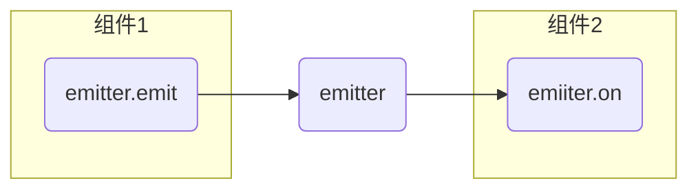
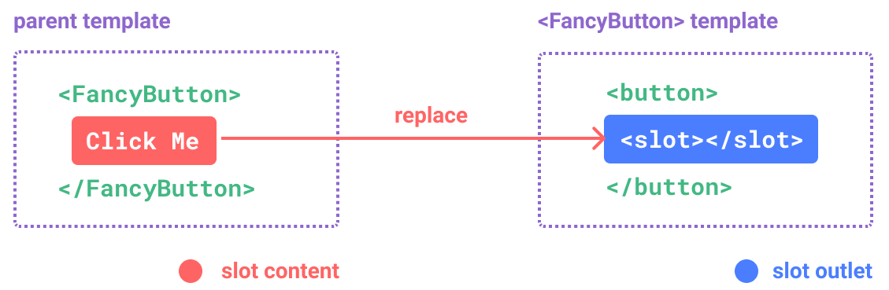
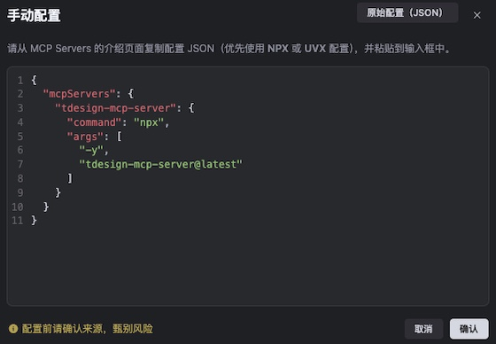

# 组件通讯

## Mitt

[Mitt](https://github.com/developit/mitt)是一个消息订阅与发布的库，可以实现任意组件的通信。使用Mitt前要先安装

```shell
npm install --save mitt
```

使用Mitt传递消息的过程



* `emitter`相当一个公告栏，所有组件的信息都发布到公告栏上。
* `emitter.emit`向公告栏发布消息。
* `emiiter.on`在公告栏上订阅消息。

`emitter`一般定义在工具包中，`src\utils\emitter.ts`文件中

```ts
import mitt from 'mitt'

type Events = {
  'send-msg': string
}

export const emitter = mitt<Events>()

export default emitter
```

* `Events`用于约定消息发送时的数据格式。

发送消息的组件

```vue
<script setup lang="ts">
import emitter from '@/utils/emitter'

function sendMsg(e: KeyboardEvent) {
  e.preventDefault()
  if (e.target instanceof HTMLInputElement) {
    const msg = e.target.value.trim()
    if (!msg) {
      return
    }

    emitter.emit('send-msg', msg)
    e.target.value = ''
  }
}
</script>

<template>
  <input type="text" @keyup.enter="sendMsg" placeholder="请输入消息" />
</template>
```

* 当输入完成时发送消息`emitter.emit('send-msg', msg)`，其中`'send-msg'`事件名称（相当于发送消息的代号）

订阅消息的组件

```vue
<script setup lang="ts">
import { reactive, onUnmounted } from 'vue'
import emitter from '@/utils/emitter'

let msgs = reactive<string[]>([])

emitter.on('send-msg', (msg: string) => {
  msgs.push(msg)
})

onUnmounted(() => {
  emitter.off('send-msg')
})
</script>

<template>
  <h3>消息板</h3>
  <div class="no-msg" v-show="msgs.length === 0">当前没有消息！</div>
  <ul class="msg">
    <li v-for="(msg, index) in msgs" :key="index">{{ msg }}</li>
  </ul>
</template>
```

* `emitter.on`订阅消息，如果接受到`'send-msg'`事件，就执行回调函数。
* 当组件卸载时，需要清理绑定事件`emitter.off('send-msg')`，防止内存泄露。

集成两个组件

```vue
<script setup lang="ts">
import MsgInputer from '@/components/msg_inputer.vue'
import MsgBoard from '@/components/msg_board.vue'
</script>

<template>
  <MsgBoard />
  <hr />
  <MsgInputer />
</template>
```

## `v-model`

主要实现父子组件间的通讯

父组件中定义属性和事件监听

```vue
<script setup lang="ts">
import MyInput from '@/components/my_input.vue'
import { ref } from 'vue'

const inputValue = ref('')
</script>

<template>
  <MyInput :modelValue="inputValue" @update:model-value="inputValue = $event" />
  <h2>{{ inputValue }}</h2>
</template>
```

* `:modelValue`绑定了属性值。
* `@update:model-value`绑定了事件监听，监听的事件名称为`update:model-value`。

在子组件中处理属性和事件监听

```vue
<script setup lang="ts">
defineOptions({ name: 'MyInput' })

defineProps(['modelValue'])
const emit = defineEmits(['update:modelValue'])

function sendMsg(e: InputEvent) {
  emit('update:modelValue', (e.target as HTMLInputElement).value)
}
</script>

<template>
  <input type="text" :value="modelValue" placeholder="请输入消息" @input="sendMsg" />
</template>
```

* `defineProps(['modelValue'])`获得`modelValue`的`props`。
* `defineEmits(['update:modelValue'])`获得`emit`来触发事件。
* `model-value`在读取`emit`时，可以使用`update:modelValue`替代。

> [!important]
>
> `v-model`是双向绑定，其本质就是将命令拆分为两部分`:moldeValue`与`update:modelValue`事件。`moldeValue`这个值是用来专用绑定`v-model`指令的。

父组件的写法可以简化为

```vue
<script setup lang="ts">
import MyInput from '@/components/my_input.vue'
import { ref } from 'vue'

const value = ref('')
</script>

<template>
  <MyInput v-model="value" />
  <h2>{{ value }}</h2>
</template>
```

> [!warning]
>
> 上面的写法在组件库中应用比较多。

### 绑定指定属性

使用`v-model`可以绑定特定名称的属性，从事实现多属性的双向绑定

```vue
<script setup lang="ts">
import MyInput from '@/components/my_input_2.vue'
import { reactive } from 'vue'

const value = reactive({ username: '', password: '' })
</script>

<template>
  <MyInput v-model:name="value.username" v-model:pwd="value.password" />
  <h2>用户名：{{ value.username }}，密码：{{ value.password }}</h2>
</template>
```

* `v-model:name`和`v-model:pwd`分别绑定了`name`和`pwd`两个属性，这两个属性都是双向绑定
* `v-model:name`等价于如下代码

```vue
<MyInput :name="value.username" @update:name="value.username" />
```

在子组件中可以接收

```vue
<script setup lang="ts">
defineOptions({ name: 'MyInput' })

defineProps(['name', 'pwd'])
const emit = defineEmits(['update:name', 'update:pwd'])

function sendNameMsg(e: InputEvent) {
  emit('update:name', (e.target as HTMLInputElement).value)
}

function sendPwdMsg(e: InputEvent) {
  emit('update:pwd', (e.target as HTMLInputElement).value)
}
</script>

<template>
  <div>
    <input type="text" :value="name" placeholder="请输入用户名" @input="sendNameMsg" />
    <input type="password" :value="pwd" placeholder="请输入密码" @input="sendPwdMsg" />
  </div>
</template>
```

* `defineProps(['name', 'pwd']`读取两个`props`属性。
* `defineEmits(['update:name', 'update:pwd'])`绑定触发事件名称。

### `useModel()`

`useModel()`是3.4版本后添加的宏定义，可以简化上面的定义过程。

1. `v-model`的基本绑定

```vue
<script setup lang="ts">
defineOptions({ name: 'MyInput' })

const modelValue = defineModel()
</script>

<template>
  <input type="text" v-model="modelValue" placeholder="请输入消息" />
</template>
```

2. `v-model`绑定特定名称的属性

```vue
<script setup lang="ts">
defineOptions({ name: 'MyInput' })

const name = defineModel('name')
const pwd = defineModel('pwd')
</script>

<template>
  <div>
    <input type="text" v-model="name" placeholder="请输入用户名" />
    <input type="password" v-model="pwd" placeholder="请输入密码" />
  </div>
</template>
```

## `$attrs`

透传属性指的是传递给一个组件，却没有被该组件接收的属性或事件。穿透属性常用于祖孙间的通讯。

1. 在App页面中编写

```vue
<script setup lang="ts">
import Next1 from '@/components/next_1.vue'
import { reactive } from 'vue'

const value = reactive(['偶来松树下，', '高枕石头眠。', '山中无历日，', '寒尽不知年。'])

const reverse = () => {
  value.reverse()
}
</script>

<template>
  <h2>{{ value[0] }}</h2>
  <Next1 :two="value[1]" :three="value[2]" :four="value[3]" @reverse="reverse" />
</template>
```

* 将属性和事件分别传入子组件。

2. 在子组件中接收

```vue
<script setup lang="ts">
import { useAttrs } from 'vue'
import Next2 from './next_2.vue'

defineProps(['two'])

const attrs = useAttrs()
console.log(attrs)
</script>

<template>
  <h3>{{ two }}</h3>
  <Next2 v-bind="$attrs" />
</template>
```

* `defineProps(['two'])`读取`props`中的`two`数据。
* `useAttrs()`可以读取`attrs`，同样的数据在模版中`$attrs`。
* `$attrs`表示了除外`two`后的所有属性和事件，`v-bind="$attrs"`统一传递给孙组件。

3. 在孙组件中接收

```vue
<script setup lang="ts">
defineProps(['three', 'four'])
defineEmits(['reverse'])
</script>

<template>
  <h4>{{ three }}</h4>
  <h4>{{ four }}</h4>
  <button @click="$emit('reverse')">反转</button>
</template>
```

* 获取`props`和调用自定义事件，与从父组件传递一致。
* `defineEmits(['reverse'])`声明了接收`reverse`事件，避免产生警告。

> [!important]
>
> 1. `$`是Vue模板中的保留前缀，以`$`开始的变量在模板中是内置关键字。
> 2. 凡事模版的内置关键字，总是可以在`<script>`标签中通过函数、宏函数或实例的API等方式获得，同样可以在代码中进行操作。

[Vue的详细API](https://cn.vuejs.org/api/)

## `provide`和`inject`

* `provide`配置可以向后代组件提供数据。
* 在后代组件中使用`inject`配置来声明接收数据。

可以实现祖孙组件间直接通信。

1. 在App中编写

```vue
<script setup lang="ts">
import Next1 from '@/components/next_11.vue'
import { reactive, provide } from 'vue'

const value = reactive(['偶来松树下，', '高枕石头眠。', '山中无历日，', '寒尽不知年。'])

const reverse = () => {
  value.reverse()
}

provide('value', value)
provide('reverse', reverse)
</script>

<template>
  <h2>{{ value[0] }}</h2>
  <h2>{{ value[1] }}</h2>
  <Next1 />
</template>
```

* `provide`函数可以提供数据和方法，第一个参数是要注入的`key`，第二个参数是要注入的值。

2. 父组件中不需要进行任何操作

```vue
<script setup lang="ts">
import Next2 from './next_22.vue'
</script>

<template>
  <hr />
  <Next2 />
</template>
```

3. 在孙组件中进行操作

```vue
<script setup lang="ts">
import { inject } from 'vue'

const others = inject<string[]>('value')
const reverse = inject<() => void>('reverse')
</script>

<template>
  <h3>{{ others?.[2] }}</h3>
  <h3>{{ others?.[3] }}</h3>
  <button @click="reverse">反转</button>
</template>
```

* 使用`inject`配置项接受数据，根据`key`获得注入值。

## 插槽

插槽用于标示父元素提供元素，在子组件中显示的位置



### 默认插槽

子组件中只有只有一个插槽

```vue
<script setup lang="ts">
defineProps(['title'])
</script>

<template>
  <div class="card">
    <h3>{{ title || '默认标题' }}</h3>
    <hr />
    <div class="content">
      <slot>内容显示为空</slot>
    </div>
  </div>
</template>
```

* `<slot>`中可以填入默认内容，如果插槽中没有填入页面元素，会显示默认内容。

父组件添加的元素，自动填入子组件的插槽

```vue
<script setup lang="ts">
import ShowCard1 from '@/components/show_card_1.vue'
</script>

<template>
  <div class="cards">
    <ShowCard1 title="题龙阳县青草湖">
      <p>西风吹老洞庭波，<br />一夜湘君白发多。<br />醉后不知天在水，<br />满船清梦压星河。</p>
    </ShowCard1>
    <ShowCard1 title="热门图片">
      
    </ShowCard1>
    <ShowCard1></ShowCard1>
  </div>
</template>
```

### 具名插槽

指定名字的插槽，解决有时在一个组件中包含多个插槽出口的问题。

在子组件中定义多个插槽

```vue
<script setup lang="ts">
defineProps(['title'])
</script>

<template>
  <div class="card">
    <slot name="title"></slot>
    <hr />
    <slot name="content"></slot>
  </div>
</template>
```

* `<slot>`中的`name`属性可以指定插槽的名称。

在父组件中添加元素

```vue
<script setup lang="ts">
import ShowCard2 from '@/components/show_card_2.vue'
</script>

<template>
  <div class="cards">
    <ShowCard2 title="题龙阳县青草湖">
      <template v-slot:title>
        <h3>题龙阳县青草湖</h3>
      </template>
      <template #content>
        <p>西风吹老洞庭波，<br />一夜湘君白发多。<br />醉后不知天在水，<br />满船清梦压星河。</p>
      </template>
    </ShowCard2>
  </div>
</template>
```

* 使用具名插槽时，填入插槽的元素必须使用`<template>`标签
* `<template>`标签，可以使用`v-slot:`指令，指定填入插槽的名称。`v-slot:`指令可以简写为`#`。

### 作用域插槽

数据在组件的自身，但根据数据的展示结构需要组件的使用者来提供。

在子组件中提供数据

```vue
<script setup lang="ts">
import { reactive } from 'vue'

const users = reactive([
  { id: 10012, name: '张三' },
  { id: 10023, name: '李四' },
  { id: 10034, name: '王五' },
])
</script>

<template>
  <div class="card">
    <slot :users="users"></slot>
  </div>
</template>
```

* `<slot>`中`:`方式向子组件提供数据，数据会包装成`{ users: [...] }`。

在父组件中获得数据

```vue
<script setup lang="ts">
import ShowCard3 from '@/components/show_card_3.vue'
</script>

<template>
  <div class="cards">
    <ShowCard3 v-slot="{ users }">
      <h3>用户列表</h3>
      <ul>
        <li v-for="user in users" :key="user.id">{{ user.name }} ({{ user.id }})</li>
      </ul>
    </ShowCard3>
    <ShowCard3 v-slot="{ users }">
      <h3>用户列表</h3>
      <ol>
        <li v-for="user in users" :key="user.id">{{ user.name }} ({{ user.id }})</li>
      </ol>
    </ShowCard3>
  </div>
</template>
```

* 在父组件中使用`v-slot`属性获得`props`数据，获得数据时需要解包。
* 数据可以在父组件中渲染。

## 组件库

Vue组件库是一套基于Vue.js框架预先编写好的用户界面组件集合。

* [Vant](https://vant-ui.github.io/vant/#/zh-CN/home)轻量、可定制的移动端Vue组件库。
* [TDesign](https://tdesign.tencent.com/)是由腾讯开源的企业级设计体系与UI组件库，TDesign支持多个框架。

安装TDesign组件库

```shell
npm i tdesign-vue-next
```

### 基础使用

基础使用会全量注册所有组件，这种方式适用项目大规模使用组件。

```ts
import { createApp } from 'vue'
import TDesign from 'tdesign-vue-next'
import App from './e-td-1.vue'

const app = createApp(App)
app.use(TDesign)
app.mount('#app')
```

* `app.use(TDesign)`添加TDesign组件库，添加组件库需要在`app.mount`前添加。

在页面中使用组件

```vue
<template>
  <t-space size="24px">
    <t-button theme="primary" variant="base">填充按钮</t-button>
    <t-button theme="default" variant="outline">描边按钮</t-button>
    <t-button theme="success" variant="dashed">虚框按钮</t-button>
    <t-button theme="warning" variant="text">文字按钮</t-button>
  </t-space>
</template>
```

### 按需引入

根据需求引入使用的组件，避免生成文件过大

```ts
import { createApp } from 'vue'
import { Button as TButton } from 'tdesign-vue-next'
import App from './e-td-2.vue'

const app = createApp(App)
app.use(TButton)
app.mount('#app')
```

页面中使用

```vue
<template>
  <t-button theme="primary" variant="base">按需引入</t-button>
</template>
```

### MCP工具

[MCP](https://tdesign.tencent.com/vue-next/mcp)工具用于在AI辅助编程的场景中更高效、更准确地使用TDesign的各种开发资源。在Trae中添加TDesign的MCP工具



## 练习

1. 使用TDesign组件完成一个任务清单工具。
