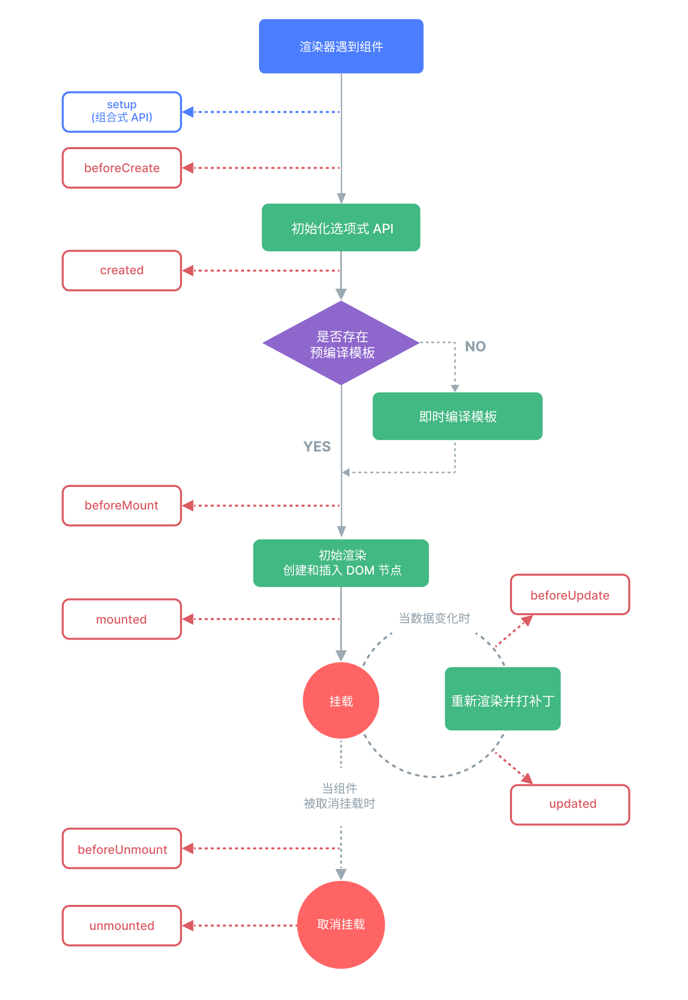

# 生命周期

每个Vue组件实例在创建时都需要经历一系列的初始化步骤。在此过程中，Vue框架会运行生命周期钩子的函数，让开发者有机会在特定阶段运行自己的代码。

Vue 3的生命周期过程



`Vue3`的生命周期函数

* 创建阶段：`setup`
* 挂载阶段：`onBeforeMount`、`onMounted`
* 更新阶段：`onBeforeUpdate`、`onUpdated`
* 卸载阶段：`onBeforeUnmount`、`onUnmounted`

生命周期的回调代码

```vue
<script setup lang="ts">
import {
  onBeforeMount,
  onBeforeUnmount,
  onMounted,
  onUnmounted,
  onBeforeUpdate,
  onUpdated,
  ref,
} from 'vue'

const count = ref(0)

console.log('header组件setup了')

onBeforeMount(() => {
  console.log('header组件挂载前')
})

onMounted(() => {
  console.log('header组件挂载完成')
})

onBeforeUnmount(() => {
  console.log('header组件卸载前')
})

onUnmounted(() => {
  console.log('header组件卸载完成')
})

onBeforeUpdate(() => {
  console.log('header组件更新前')
})

onUpdated(() => {
  console.log('header组件更新完成')
})
</script>

<template>
  <h1>{{ count }}</h1>
  <button @click="count++">Add 1</button>
</template>

<style scoped></style>
```

* `onMounted`中发起数据请求。
* `onBeforeUnmount`进行清理工作，如：清除定时器或事件监听。

## `nextTick()`

在Vue中更改响应式状态时，DOM更新不是同步生效，而是由Vue将它们缓存在一个队列中，在某一时刻一起执行。`nextTick()`可以在状态改变后立即使用，以等待DOM更新完成。

```vue
<script setup lang="ts">
import { ref, nextTick } from 'vue'

const count = ref(0)

async function increment() {
  count.value++
  console.log('DOM 还未更新:', document.getElementById('counter')?.textContent) // 0
  await nextTick()
  console.log('DOM 此时已经更新:', document.getElementById('counter')?.textContent) // 1
}
</script>

<template>
  <button id="counter" @click="increment">{{ count }}</button>
</template>
```

* 按钮出发时DOM并没有更新，DOM会在`nextTick()`执行后同步更新。

`nextTick()`的应用

```vue
<script setup lang="ts">
import { ref, nextTick, useTemplateRef } from 'vue'

let search = useTemplateRef<HTMLInputElement>('search')

const flag = ref(false)

async function handleClick() {
  flag.value = true
  await nextTick()
  search.value?.focus()
}
</script>

<template>
  <button v-if="!flag" @click="handleClick">点击搜索</button>
  <input ref="search" v-else type="text" placeholder="这是一个输入框" @blur="flag = false" />
</template>
```

* `handleClick`点击按钮后，等待搜索框显示，使搜索框聚焦。

## 组合式函数

组合式函数（自定义Hook）一个利用Vue的组合式API来封装和复用有状态逻辑的函数。

> [!important]
>
> 对数据和功能进行封装，复用代码，使`setup`中的逻辑更清晰。

一般组合是api定义在`src/composables`文件夹下，使用`use`开头。

```ts
import { reactive, onMounted } from 'vue'
import axios, { AxiosError } from 'axios'

export default function () {
  let dogList = reactive<string[]>([])

  async function getDog() {
    try {
      let { data } = await axios.get('https://dog.ceo/api/breeds/image/random')
      dogList.push(data.message)
    } catch (error) {
      const err = <AxiosError>error
    }
  }

  onMounted(() => {
    getDog()
  })

  return { dogList, getDog }
}
```

* 在组合式API中可以：定义响应式数据，调用生命周期函数。
* 在组合式API中可以：返回数据和方法。

在组件中可以使用组合式函数

```vue
<script setup lang="ts">
import useDog from '@/composables/useDog'

const { dogList, getDog } = useDog()
</script>

<template>
  <button @click="getDog">获取随机狗</button>
  <hr />
  <div class="pack">
    
  </div>
</template>
```
