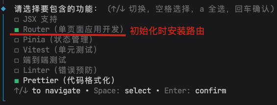

# 路由

[Vue Router](https://router.vuejs.org/zh/)是Vue的官方插件，用于在SPA应用在不同页面间切换。

1. 创建Vue项目时可以默认选择安装路由



2. 在已有项目中单独安装路由

```shell
npm install vue-router
```

路由与路由器

* 路由：SPA应用中的路由是一组映射规则，将一组URL地址与组件映射起来，根据URL地址的变换来切换页面组件。
* 路由器：路由器是用来管理路由的JavaScript对象。

## 路由配置

在Vue中路由，一般专门配置在`src/router/index.ts`文件下

```ts
import { createRouter, createWebHistory } from 'vue-router'

// 路由器实例，用于管理路由。
const router = createRouter({
  // 设置路由的模式
  history: createWebHistory(),
  // 用于设置路由路径
  routes: [],
})

export default router // 将路由器导出可以在App中使用。
```

* `history`属性用于设置路由的模式
  * `createWebHistory()`模式
    * URL更加美观，不带有`#`，更接近传统的网站URL。
    * 后期项目上线，需要服务端配合处理路径问题，否则刷新会有`404`错误。
  * `createWebHashHistory()`模式
    * 兼容性更好，因为不需要服务器端处理路径。
    * URL带有`#`不太美观，且在SEO优化方面相对较差。

在`main.ts`中使用路由器功能

```ts
import { createApp } from 'vue'
import App from './App.vue'
import router from './router'

const app = createApp(App)

app.use(router)
app.mount('#app')
```

### 组件的分类

* 通用组件：在不同的页面中可以复用的组件，如：按钮、数据卡片等。
* 页面组件：显示页面信息，通过URL地址访问，虽然被称为页面，但本质上还是Vue的组件。

Vue中组件的管理

```shell
.
├── src
│   ├── components     # 通用组件
│   ├── pages          # 页面组件
│   │   ├── recipes.vue
│   │   ├── todoes.vue
│   │   └── user.vue
│   ├── router         # 路由配置
│   ├── App.vue
│   └── main.ts
...
```

路由配置中，创建路由与页面的映射

```ts
const router = createRouter({
  history: createWebHistory(),
  routes: [
    {
      path: '/',
      component: Recipes,
    },
    {
      path: '/todoes',
      component: Todoes,
    },
    {
      path: '/user',
      component: User,
    },
  ],
})
```

