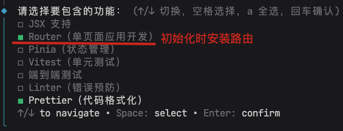

# 路由

[Vue Router](https://router.vuejs.org/zh/)是Vue的官方插件，用于在SPA应用在不同页面间切换。

1. 创建Vue项目时可以默认选择安装路由



2. 在已有项目中单独安装路由

```shell
npm install vue-router
```

路由与路由器

* 路由：SPA应用中的路由是一组映射规则，将一组URL地址与组件映射起来，根据URL地址的变换来切换页面组件。
* 路由器：路由器是用来管理路由的JavaScript对象。

## 路由配置

在Vue中路由，一般专门配置在`src/router/index.ts`文件下

```ts
import { createRouter, createWebHistory } from 'vue-router'

// 路由器实例，用于管理路由。
const router = createRouter({
  // 设置路由的模式
  history: createWebHistory(),
  // 用于设置路由路径
  routes: [],
})

export default router // 将路由器导出可以在App中使用。
```

* `history`属性用于设置路由的模式
  * `createWebHistory()`模式
    * URL更加美观，不带有`#`，更接近传统的网站URL。
    * 后期项目上线，需要服务端配合处理路径问题，否则刷新会有`404`错误。
  * `createWebHashHistory()`模式
    * 兼容性更好，因为不需要服务器端处理路径。
    * URL带有`#`不太美观，且在SEO优化方面相对较差。

在`main.ts`中使用路由器功能

```ts
import { createApp } from 'vue'
import App from './App.vue'
import router from './router'

const app = createApp(App)

app.use(router)
app.mount('#app')
```

### 组件的分类

* 通用组件：在不同的页面中可以复用的组件，如：按钮、数据卡片等。
* 页面组件：显示页面信息，通过URL地址访问，虽然被称为页面，但本质上还是Vue的组件。

Vue中组件的管理

```shell
src
├── assets                     # 全局样式
├── App.vue
├── components                 # 通用组件
│   ├── product-detail.vue
│   └── recipe-detail.vue
├── pages                      # 页面组件
│   ├── products.vue
│   ├── recipes.vue
│   ├── todos.vue
│   └── user.vue
├── router                     # 路由配置
│   └── index.ts
└── main.ts
```

* 页面组件通常保存在`pages`和`viwes`文件夹内。

路由配置中，创建路由与页面的映射

```ts
const router = createRouter({
  history: createWebHistory(),
  routes: [
    {
      path: '/',          // 重定向根路由
      redirect: '/user',
    },
    {
      path: '/user',      // 表示路由路径
      component: User,    // 表示映射的页面组件
    },
    {
      name: 'todos',      // 可以给路由起名字
      path: '/todos',
      component: Todos,
    },
    {
      name: 'recipes',
      path: '/recipes',
      component: Recipes,
      children: [],       // 配置子路由
    },
    ...
  ],
})
```

* 重定向可以指定路径打开后默认跳转的页面。重定向根路由可以指定，根路径默认跳转的页面。
* 路由名字也可以用于页面跳转。

### 声明式导航

在页面中使用路由组件`RouterLink`类，配置页面导航为声明式导航。

```vue
<script setup lang="ts">
import { RouterLink, RouterView } from 'vue-router'
</script>

<template>
  <div class="nav">
    <!-- 声明式导航 -->
    <RouterLink class="nav-link" to="/user">用户</RouterLink>
    <RouterLink class="nav-link" :to="{ path: '/todos' }">待办事项</RouterLink>
    <RouterLink class="nav-link" :to="{ name: 'recipes' }">食谱</RouterLink>
    <RouterLink class="nav-link" :to="{ name: 'products' }">商品</RouterLink>
  </div>
	<!-- 展示区 -->
  <RouterView />
</template>

```

1. 直接使用路径进行导航

```html
<RouterLink class="nav-link" to="/user">用户</RouterLink>
```

2. 使用对象配置路径导航，需要使用Vue的绑定属性写法。

```html
<RouterLink class="nav-link" :to="{ path: '/todos' }">待办事项</RouterLink>
```

3. 命名路由，给路由规则命名。使用对象配置命名路由。

```html
<RouterLink class="nav-link" :to="{ name: 'recipes' }">食谱</RouterLink>
```

`<RouterView />`作为挂载点用于切换不同的路由页面。

> [!important]
>
> 默认情况下，路由组件消失，实际是被销毁；路径组件显示，实际是重新创建页面。

### 嵌套路由

在一级路由下可以嵌套二级路由

```ts
const router = createRouter({
  history: createWebHistory(),
  routes: [
		...
    {
      name: 'recipes',
      path: '/recipes',
      component: Recipes,
      children: [
        {
          name: 'recipe-detail',         // 配置子路由映射的页面
          path: 'detail',
          component: RecipeDetail,
        },
      ],
    },
    {
      name: 'products',
      path: '/products',
      component: Products,
      children: [
        {
          name: 'product-detail',
          path: 'detail/:id/:name',
          component: ProductDetail,
        },
      ],
    },
  ],
})
```

1. 使用路径实现子路由导航

```html
<div class="container">
	...
  <div class="recipes">
    <ul>
      <li v-for="recipe in recipes" :key="recipe.id">
        <RouterLink :to="{ path: '/recipes/detail' }">
          <h3>{{ recipe.name }}</h3>
        </RouterLink>
      </li>
    </ul>
		...
  </div>
</div>
```

